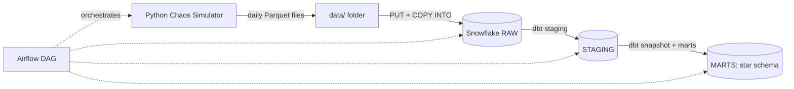

# Architecture

## Layers
- **RAW**: data exactly as received, plus load metadata
- **STAGING**: cleaned, typed, deduplicated
- **MARTS**: fct_order_items, dim_customer (SCD2), dim_product, dim_date
